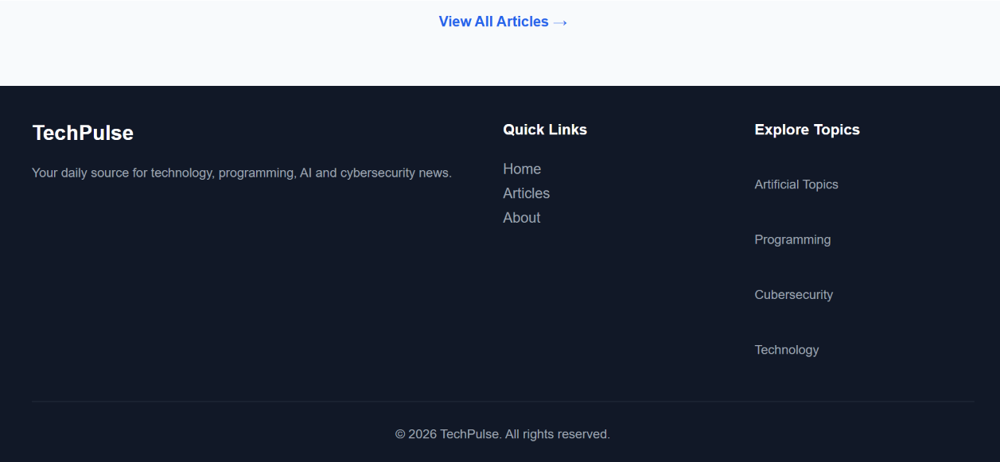

# TechPulse

### Stay Ahead with the Latest Technology News

TechPulse is a modern and responsive technology news plateform built with react. It allows users to explore the latest technology articles, search for articles, and read detailed information.

## Features

- Browse latest technology articles.
- Search articles.
- View individual article details.
- Responsive design for different screen sizes.
- Reusable article card components.
- Automatic API data fetching.
- Loading states.
- Articles images with fallback support.

## Technologies Used

- React.js
- Vite
- JavaScript
- CSS3
- React Router DOM
- Hacker News API

## API Integration

TechPulse uses the Hacker News API to retrieve technology-related articles.

API Documentations:
https://github.com/HackerNews/API

## Installation & Setup

1. Clone the repository:

    git clone YOUR_GITHUB_REPOSITORY_URL

2. Navigate to the project folder:

    cd TechPulse

3. Install dependencies:

    npm install

4. Start the development server:

    npm run dev

5. Open the local URL provided by Vite.

## Screenshots

## Future Improvements

- Improve articles images handling.
- Add more article categories.
- Enhance user experience.

## Author 

Waseem Khan

Software Engineering Students